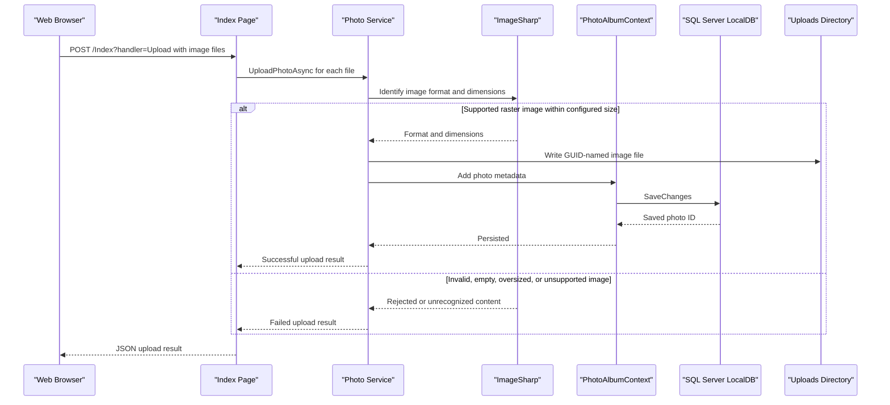

# API & Service Communication Contracts

PhotoAlbum exposes browser-oriented Razor Pages and one JSON upload handler. Its HTTP request processing and photo operations remain within one application; no inter-service API communication was identified.

## Service Catalog

| Service | Port | Category | Purpose |
|---|---|---|---|
| PhotoAlbum | 8080 in Docker; 5134/7055 in development launch profiles | API Layer | Serves the gallery, photo details/files, login, and upload handling |

## API Endpoints Inventory

| Service | Method | Path | Request Type | Response Type |
|---|---|---|---|---|
| PhotoAlbum | GET | `/` | None | Gallery HTML |
| PhotoAlbum | POST | `/Index?handler=Upload` | Multipart form files (`List<IFormFile>`) | JSON upload status, photo metadata, and failed-upload details |
| PhotoAlbum | GET | `/Detail/{id?}` | Optional integer route ID | Photo detail HTML or not found |
| PhotoAlbum | POST | `/Detail/{id}?handler=Delete` | Integer route ID; authenticated cookie required | Redirect to gallery or detail page |
| PhotoAlbum | GET | `/photo/{id:int}` | Integer route ID | Image file response or not found |
| PhotoAlbum | GET | `/Login` | None | Login HTML |
| PhotoAlbum | POST | `/Login` | Username and password form values | Sign-in cookie and redirect, or login page with error |
| PhotoAlbum | GET | `/Privacy` | None | Privacy HTML |

No explicit API versioning scheme or OpenAPI specification was found.

## Management & Observability Endpoints

| Service | Endpoint | Custom Metrics |
|---|---|---|
| PhotoAlbum | None identified | None identified |

## DTOs & Contracts

`UploadResult` carries the service's upload outcome, photo ID, submitted filename, and any user-facing error. The upload handler returns an anonymous JSON contract containing success status, uploaded photo details, and failed uploads. `Photo` is the service-level persistence entity and is also used to populate page responses. The request uses ASP.NET Core's `IFormFile`; no separate gateway DTO, OpenAPI definition, protobuf schema, or GraphQL schema was found. JSON serialization uses ASP.NET Core defaults.

## Communication Patterns

Razor Page handlers call `IPhotoService` synchronously within the application request flow; the service uses asynchronous EF Core and filesystem APIs. There are no message queues, external HTTP clients, service discovery, gateway aggregation, retries, or circuit breakers configured. HTTPS redirection and cookie authentication are enabled; the gallery and upload handlers are not authorization-protected, while photo deletion checks authentication. No explicit TLS termination or authorization policy beyond that check was found in the application configuration.

## Service Technology Matrix

| Service | Web | Data Access | Discovery | Gateway | Health | Cache | Metrics |
|---|---|---|---|---|---|---|---|
| PhotoAlbum | Razor Pages | EF Core SQL Server | None | None | None identified | HTTP response caching for files | None identified |

## Service Communication Sequence

