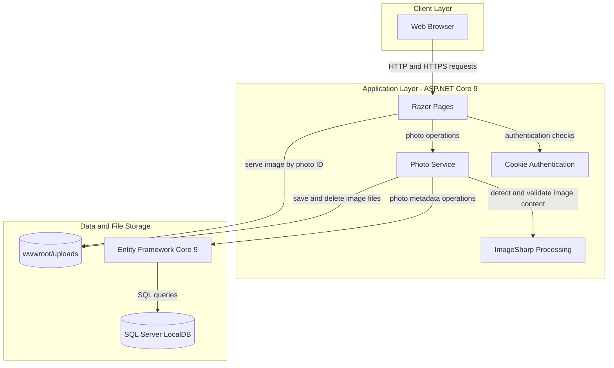
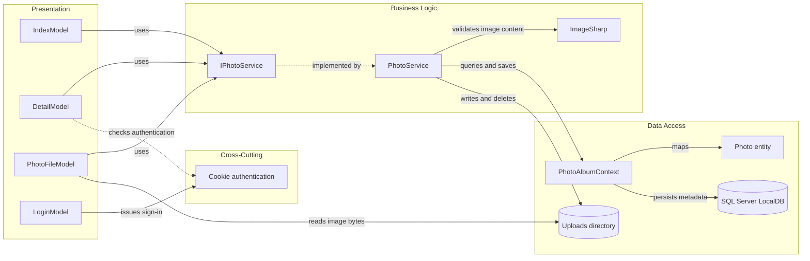

# Architecture Diagram

PhotoAlbum is a single web application with a browser-facing Razor Pages layer, photo operations, persistence, and local image-file storage.

## Application Architecture

### Technology Stack Summary

| Layer | Technology | Version | Purpose |
|---|---|---:|---|
| Presentation | ASP.NET Core Razor Pages | 9.0 | Server-rendered gallery, details, login, and upload interaction |
| Business logic | C# / .NET | net9.0 | Photo validation, metadata, and file operations |
| Image processing | SixLabors.ImageSharp | 3.1.11 | Detect raster image formats and dimensions |
| Data access | Entity Framework Core | 9.0.9 | Persist and query photo metadata |
| Database | SQL Server LocalDB | configured | Store photo metadata |
| File storage | Local filesystem | N/A | Store uploaded images under `wwwroot/uploads` |

### Data Storage & External Services

Photo metadata is stored in SQL Server LocalDB, while image bytes are stored in the application's local uploads directory. No external service, message broker, or cache is configured.

### Key Architectural Decisions

- Razor Pages invoke `IPhotoService`, which encapsulates upload, retrieval, and deletion operations.
- EF Core persists metadata separately from filesystem image content; upload rolls back the file if metadata persistence fails.
- Cookie authentication protects destructive photo deletion; gallery browsing and uploads are otherwise served by the same application.

## Component Relationships

### Component Inventory

| Component | Layer | Type | Responsibility |
|---|---|---|---|
| IndexModel | Presentation | Razor Page model | Lists photos and handles upload requests |
| DetailModel | Presentation | Razor Page model | Displays a photo and handles authenticated deletion |
| PhotoFileModel | Presentation | Razor Page model | Retrieves and serves an image by photo ID |
| LoginModel | Presentation | Razor Page model | Authenticates the configured administrator |
| IPhotoService | Business Logic | Service interface | Defines photo retrieval, upload, and deletion operations |
| PhotoService | Business Logic | Service | Validates images and coordinates file and metadata persistence |
| PhotoAlbumContext | Data Access | EF Core DbContext | Maps and queries photo metadata |
| Photo | Data Access | Entity | Represents photo metadata stored in the database |
