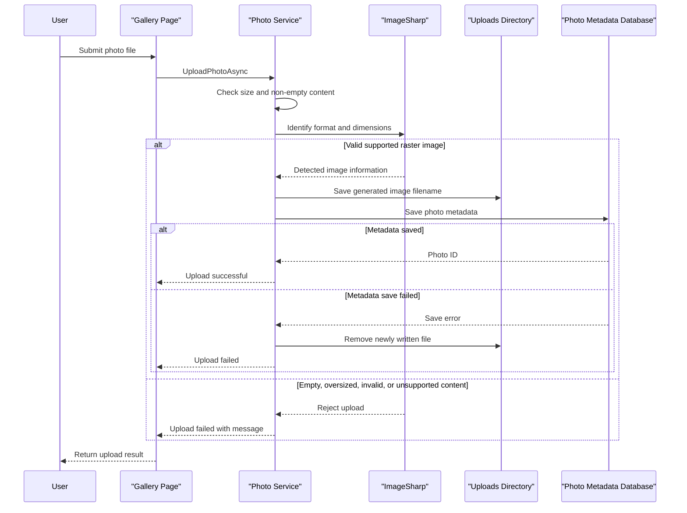

# Core Business Workflows

PhotoAlbum allows users to browse, upload, and view photos, while an authenticated administrator can delete photos. Upload handling validates image content and keeps local image files coordinated with database metadata.

## Domain Entities

| Entity | Service / Bounded Context | Description | Key Relationships |
|---|---|---|---|
| Photo | PhotoAlbum / Photo Gallery | A user-uploaded image together with display and storage metadata | No related domain entities identified |

## Service-to-Domain Mapping

| Service | Domain Context | Owned Entities | External Dependencies |
|---|---|---|---|
| PhotoAlbum | Photo Gallery | Photo | SQL Server LocalDB and local filesystem |

There are no separate services or cross-context data exchanges. `PhotoService` is the source of truth for photo metadata and coordinates image-file operations.

## Primary Workflows

### Workflow 1: Upload a Photo

1. A user submits one or more files through the gallery upload handler.
2. The photo service rejects empty or oversized files, identifies the actual image format from content, and allows only supported raster formats.
3. The service generates a GUID-based stored filename and writes the image to the upload directory.
4. It records the original name and image metadata in the database.
5. If metadata persistence fails, the service attempts to remove the newly written file; the handler returns successful and failed upload results as JSON.

The configured per-file size limit is 10 MB, and allowed formats are JPEG, PNG, GIF, and WebP.

### Workflow 2: Browse and View a Photo

1. The gallery loads photos in descending upload-time order.
2. A user selects a photo detail page, which loads photo metadata and provides adjacent-photo navigation.
3. The image is served through an ID-based file handler; absent metadata or an absent image file returns not found.

### Workflow 3: Delete a Photo

1. An administrator submits the delete action from a photo detail page.
2. The handler requires an authenticated user and asks the service to locate the photo.
3. The service attempts to delete the associated file, then removes the metadata record.
4. The handler redirects to the gallery on success or back to the detail page after an exception.

## Cross-Service Data Flows

No cross-service or gateway aggregation flow exists. The local `PhotoService` associates a database metadata record with a file stored under the uploads directory. On upload persistence failure, deletion of the new file is a compensating action; on photo deletion, file deletion is attempted before database deletion.

## Business Workflow Sequence

## Business Rules & Decision Logic

- Uploads must be non-empty, within the configured maximum size, and recognized as supported raster image content. Client-provided MIME type and filename do not determine the stored format.
- Stored file names are generated by the service; the original filename is retained as display metadata.
- A failed database save after file creation triggers an attempt to delete the newly created file.
- Photo deletion requires an authenticated user. Login credentials are configured externally; absent administrator password configuration, login fails closed.
- The database records upload timestamps in UTC and indexes them for newest-first gallery queries.
- Photo/file persistence spans the database and filesystem without a shared distributed transaction; compensating file deletion is used on upload metadata failure.
