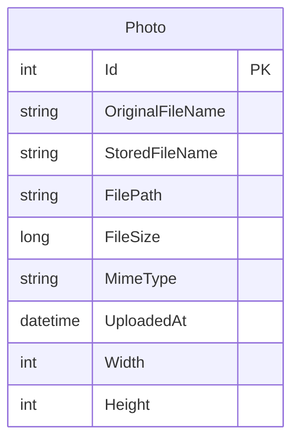

# Data Architecture & Persistence Layer

PhotoAlbum persists one photo metadata entity through Entity Framework Core 9 and SQL Server LocalDB. Image bytes are stored separately in the local uploads directory.

## Database Configuration

| Service/Module | DB Type | Profile | Driver | Connection | Migration Tool |
|---|---|---|---|---|---|
| PhotoAlbum | SQL Server LocalDB | Default and Development | EF Core SQL Server 9.0.9 | LocalDB `PhotoAlbumDb` using trusted connection | EF Core migrations applied at startup except when `IsTestEnvironment` is true |
| PhotoAlbum.Tests | EF Core InMemory | Tests | EF Core InMemory 9.0.9 | In-memory test database | No migration tool used in tests |

No seed data or additional database profile was identified.

## Data Ownership per Service

| Service | Tables Owned | ORM Framework | Caching | Notes |
|---|---|---|---|---|
| PhotoAlbum | Photos | Entity Framework Core 9 | None | Metadata in SQL Server; image bytes live on local disk |

## Entity Model

The single `Photo` entity is defined in `PhotoAlbum/Models/Photo.cs`. It has a primary key and a descending index on upload timestamp; no entity relationships were identified. `PhotoAlbumContext` configures required metadata fields and maximum lengths in `PhotoAlbum/Data/PhotoAlbumContext.cs`. Metadata changes use EF Core `SaveChangesAsync`; no explicit transaction scope is defined beyond EF Core's save behavior.

## Key Repository Methods

| Service | Repository | Notable Methods | Purpose |
|---|---|---|---|
| PhotoAlbum | `PhotoAlbumContext.Photos` (`PhotoAlbum/Data/PhotoAlbumContext.cs`) | `GetAllPhotosAsync`; `GetPhotoByIdAsync`; `AddAsync` and `SaveChangesAsync`; `Remove` and `SaveChangesAsync` in `PhotoService` | Retrieve, create, and delete photo metadata; no custom repository interface or query methods are defined |

## Caching Strategy

No data or query cache is configured. Photo-file responses set HTTP cache headers; this is client/proxy response caching rather than a database caching layer.

## Data Ownership Boundaries

One application owns the photo metadata database and local image files. No cross-service data access, shared database between services, or CQRS pattern was identified. File data and relational metadata are coordinated by `PhotoService`; if metadata persistence fails after a file write, the service attempts to delete the new file.

### Data Classification & Sensitivity

| Entity | Sensitive Fields | Classification (PII/PHI/PCI/None) | Controls in Place |
|---|---|---|---|
| Photo | Original file name and photo image content may identify a person | Potential PII | No field-level masking or encryption-at-rest configuration was identified; database/file protection depends on the host environment |

