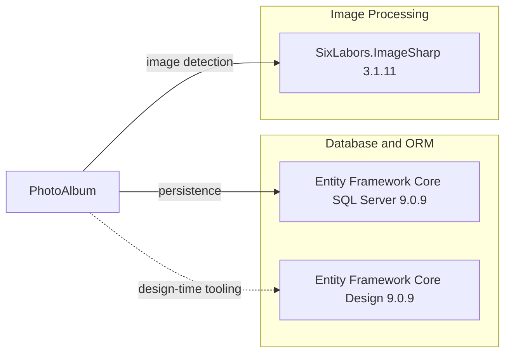

# Dependency Map

PhotoAlbum declares three application dependencies and six test dependencies across its web and test projects.

## Dependencies

### Dependency Summary

| Category | Count | Key Libraries | Notes |
|---|---:|---|---|
| Database / ORM | 2 | Microsoft.EntityFrameworkCore.SqlServer 9.0.9; Microsoft.EntityFrameworkCore.Design 9.0.9 | The design package is private tooling; SQL Server package provides EF Core SQL Server integration |
| Utilities | 1 | SixLabors.ImageSharp 3.1.11 | Image decoding and format/dimension identification |

### Version & Compatibility Risks

The project targets .NET 9 and its EF Core packages are version 9.0.9. GitHub's advisory database reported six findings affecting the declared SixLabors.ImageSharp 3.1.11 package; the advisories list 3.2.0 as the patched version for that package series.

### Notable Observations

- The web application uses the ASP.NET Core shared framework from `Microsoft.NET.Sdk.Web`; it is not separately declared as a package reference.
- ImageSharp is a security-sensitive dependency because it processes attacker-supplied image content.
- EF Core Design is private to the application project and is not a runtime dependency.

## Test Dependencies

| Framework | Version | Notes |
|---|---:|---|
| Microsoft.AspNetCore.Mvc.Testing | 9.0.9 | ASP.NET Core integration-test host |
| Microsoft.EntityFrameworkCore.InMemory | 9.0.9 | In-memory provider for tests |
| Microsoft.NET.Test.Sdk | 17.12.0 | Test execution infrastructure |
| xunit | 2.9.2 | Test framework |
| xunit.runner.visualstudio | 2.8.2 | Visual Studio test adapter |
| coverlet.collector | 6.0.2 | Coverage collection |

Total test-scope dependencies: 6

The test project uses xUnit and ASP.NET Core's test host with an in-memory EF Core provider. No contract-testing dependency is declared.
